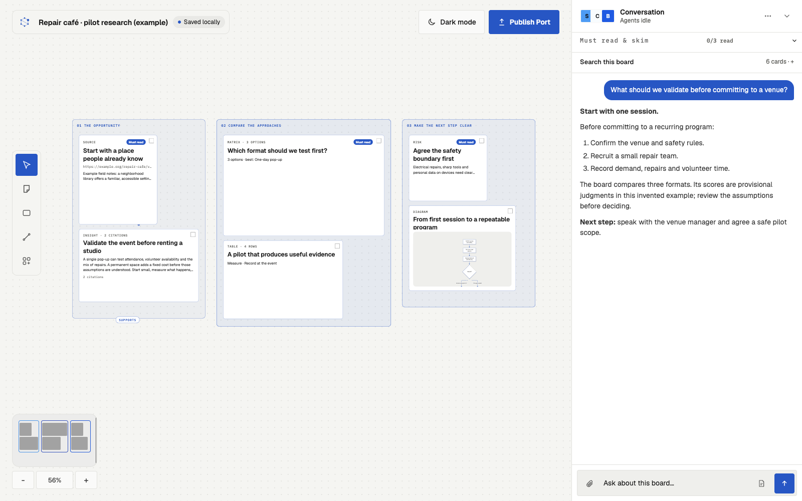
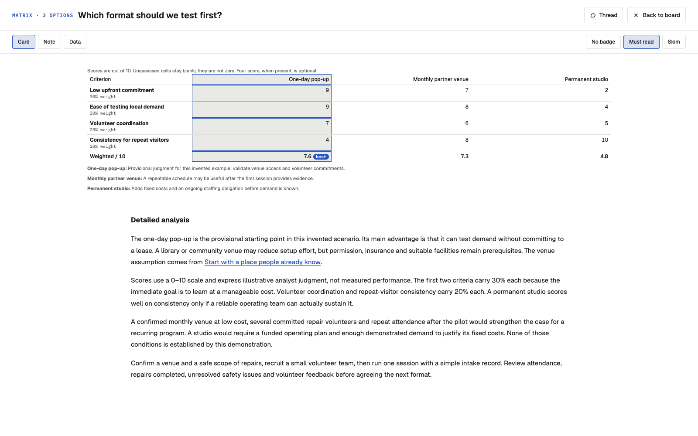
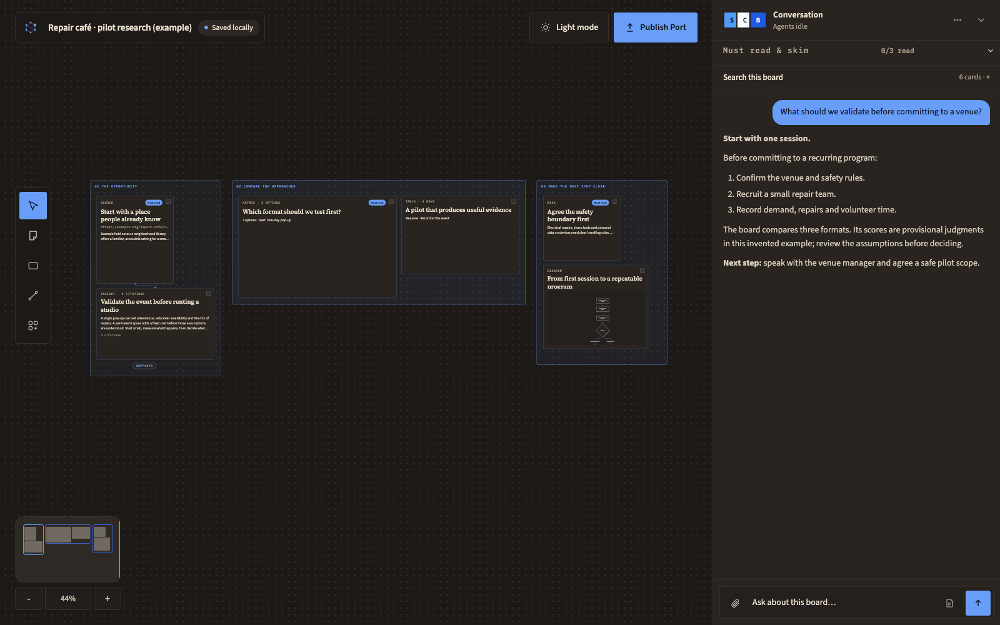

# orb

**Research you can see, question and build on.**

A local-first research workspace for your Mac. Start with a question; work with AI agents on a canvas of sources,
comparisons, questions and decisions. Open any card to read the detail, follow the evidence, then shape the work
into a research document or presentation.

**[Download orb 0.1.0 for Mac](https://orb.tejassuds.com/download)** (Apple silicon, macOS 14+, signed and notarised) ·
[Website](https://orb.tejassuds.com) · [Release notes](https://github.com/tejassudsfp/orb-research/releases/tag/v0.1.0)

[Get started](docs/GETTING_STARTED.md) · [Product brief](docs/PRODUCT_BRIEF.md) · [Model connections](docs/MODELS.md) ·
[Documentation](docs/README.md) · [Contributing](CONTRIBUTING.md) · [MIT license](LICENSE)



*Actual app, invented example content. No private research boards are used in these screenshots.*

## What you can do

- **Keep the research together.** An infinite canvas with frames, connected cards, tables, datasets, charts,
  timelines, comparison matrices, diagrams and editable notes.
- **Work with a small research team.** orb coordinates Scout for evidence, Critic for challenges and Builder for
  synthesis and visual work. Ask follow-up questions in chat or start a thread on a specific card.
- **Read beyond the preview.** Full-screen readers, readable table cells, pinned matrix criteria and zoomable diagrams.
- **Trace the evidence.** Sources, quotations, provenance and card references stay attached to the analysis.
  Search the board to revisit what supports a conclusion.
- **Make a useful deliverable.** Compose research documents, a board PDF or a presentation from the board.
  Review the evidence and unknowns before exporting.
- **Make it comfortable.** Studio, Paper, Pebble, Postcard, Meadow and Tide; independent accents and Light / Dark /
  System modes, remembered locally.

<table>
<tr>
<td width="50%"></td>
<td width="50%"></td>
</tr>
<tr>
<td><strong>Room to understand.</strong> Open a comparison and read its reasoning alongside the scores.</td>
<td><strong>Your preferred surface.</strong> Typography, spacing and shape change with the style.</td>
</tr>
</table>

## Research takes time

orb is not a chat window that answers in seconds. Scout searches and reads sources, Critic checks claims and looks
for gaps, and Builder lays out comparisons, tables and diagrams. A focused question can take a few minutes, and a
broad one much longer, while its cost depends on your model route. Watch progress on the board, answer the agents'
questions, redirect them or stop them at any time. The board is saved as it fills in.

## Install

1. [Request the download](https://orb.tejassuds.com/download): enter your email and we'll send you the link (checksum on the
   [release page](https://github.com/tejassudsfp/orb-research/releases/tag/v0.1.0)). Or build it yourself; see below.
2. Open it and drag **orb** to Applications. The app is signed with a Developer ID and notarised by Apple.
3. Open orb, then add a model key or connect an eligible ChatGPT plan in **Settings → Models**.

## Your models, your choice

orb has no required orb account or orb model subscription. You connect the inference route you want:

| Route | How it works | Who bills the usage |
| --- | --- | --- |
| **Bring your own key (BYOK)** | Add a provider key in Settings; choose models per agent. Built-in providers and compatible custom endpoints are supported. | Your provider, under its API pricing |
| **ChatGPT subscription** | Choose **Continue with ChatGPT**, authorize eligible plan usage in the browser, test the connection, then select the returned models. | Your ChatGPT plan/credits, within OpenAI's limits and eligibility |

Eligible ChatGPT Plus/Pro accounts can use the documented open-source/local-app flow without entering an OpenAI
API key. All agents share the account allowance. Available models depend on the account and workspace. orb keeps
plan usage separate from API cost estimates and does not silently switch to a billed API key if the plan fails.
[Set up ChatGPT plan usage](docs/CHATGPT_PLAN.md).

Public browser search and rendered-page reading need no separate search API subscription. Optional Parallel and
other API-backed search services require their own keys and may charge separately. A custom provider's chat-app
subscription only works if that provider explicitly supports a compatible API/subscription route; it is not
interchangeable with an API key. See [models and costs](docs/MODELS.md).

## Run locally

**Current target:** Apple silicon, macOS 14+. Node.js 22.19+ and pnpm 10.34.7.

```sh
git clone https://github.com/tejassudsfp/orb-research.git
cd orb-research
corepack enable
corepack prepare pnpm@10.34.7 --activate
pnpm install --frozen-lockfile
pnpm dev
```

Configure a model in **Settings → Models**. Keys are stored in the macOS Keychain. You can also explore the
workspace without a model; agent research requires a working connection. Full instructions, local data locations
and troubleshooting are in [Getting started](docs/GETTING_STARTED.md).

**Release status:** 0.1.0, an early release for Apple silicon Macs. Release DMGs are Developer ID signed and
notarised; local `pnpm dist:adhoc` builds are ad-hoc signed. Windows/Linux builds are not validated. See
[changelog](CHANGELOG.md), [roadmap](ROADMAP.md) and [release procedure](docs/RELEASING.md).

## Privacy

Boards and attachments live on your Mac. There is no orb telemetry, analytics, crash-report upload or cloud sync.
Using agents sends relevant prompts and research context to your selected providers; searching or opening a source
contacts that service/site. Without a search API key, Scout searches the public web through Bing (DuckDuckGo as a
fallback) in a private, sandboxed browser window. Local research files and diagnostic logs are not encrypted by orb. Review content before
sharing reports or logs. [Data and privacy](docs/PRIVACY.md) explains the boundaries.

## For developers

```sh
pnpm build                  # typecheck, packages, UI and Electron
pnpm test                   # unit and integration suite; mock providers
pnpm lint
pnpm release:check          # public source/documentation checks
pnpm e2e                    # Electron browser tests (macOS)
pnpm dist:adhoc             # local, unsigned (ad-hoc) DMG
pnpm release:mac            # signed + notarised DMG (maintainers; see docs/RELEASING.md)
pnpm site:dev               # local marketing site
pnpm site:build             # portable static site output
pnpm --filter @orb/site build:vercel   # the Vercel deployment output (static pages + bug-report function)
pnpm site:test              # responsive, theme, keyboard and accessibility checks
pnpm site:start             # production website + bug-report server after site:build
pnpm site:resend-key        # save/rotate the local website sending key in macOS Keychain
```

| Path | Responsibility |
| --- | --- |
| `apps/desktop` | Electron shell, native integrations, sidecar lifecycle |
| `apps/ui` | Canvas, card readers, conversation and output views |
| `apps/site` | Marketing site using the app's theme engine |
| `packages/shared` | Board/wire contracts, themes, card registry and research templates |
| `packages/orb-agents` | Prompts, delegation, controls and completion review |
| `packages/orb-canvas` | Board log, datasets, search and layout; the sole board writer |
| `packages/orb-sources` | Source fetching, browser research and optional Parallel integration |
| `packages/orb-port` | Research document and presentation composition/export |
| `packages/orb-host` | App/sidecar endpoints and native bridges |
| `packages/orb-keychain` | Credential storage |

Electron · React · TypeScript · pnpm · DeepSeek Harness sidecar.
Start with [Contributing](CONTRIBUTING.md), [architecture](docs/ARCHITECTURE.md) and the [documentation index](docs/README.md).

## License and maintainer

Created and maintained by [Tejas Parthasarathi Sudarshan](https://tejassuds.com) ·
[@tejassudsfp](https://github.com/tejassudsfp).

[MIT licensed](LICENSE). Theme design and the public presentation are inspired by
[Symplist](https://github.com/tejassudsfp/symplist); [third-party notices](THIRD_PARTY_NOTICES.md) are retained.
