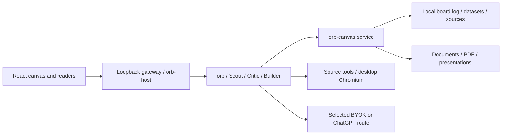

# Architecture

orb is an Electron desktop application with a React UI and a local DeepSeek Harness sidecar. The renderer talks
to the authenticated loopback gateway and orb's typed host endpoints. The harness runs coordination and scoped
research tools. Provider configuration determines where inference requests go.

## Boundaries

The canvas service is the only board writer. It validates commands, appends events and exposes query/update
operations; the UI follows the folded state. Harness sessions use native event types, with board state in the
separate `board.jsonl` file. Credentials are retrieved through the Keychain adapter, never stored on cards.

orb, Scout, Critic and Builder have distinct prompts and allowlists. Research agents have no shell, code execution
or generic filesystem tools. Source fetching, browser reading and native export use constrained services.
Only `orb-host`, `orb-agents` and `orb-canvas` import harness APIs.

## Repository map

See the root README for packages. `apps/site` is a static marketing page, built separately with Vite. It imports
shared theme tokens but has no sidecar, research tools or provider credentials. Its screenshots come from the
isolated fixture in `scripts/testkit/showcase.ts` and the real Electron app.

The original [build plan](BUILD_PLAN.md), [harness audit](DSH_DEEP_DIVE.md) and [harness notes](HARNESS_NOTES.md)
contain lower-level contracts and historical discoveries. Installed code takes precedence over old API notes.
